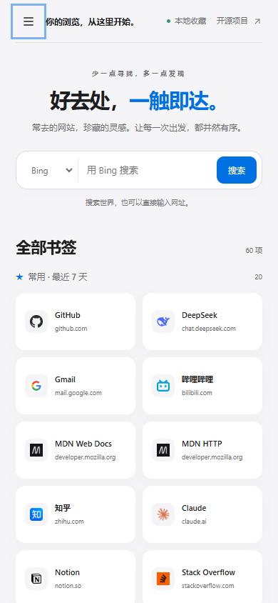

# 书签导航 · edge-nav

**好去处，一触即达。** 一个以本地收藏夹为数据源的 Chrome / Edge 新标签页扩展。

[](LICENSE)

参考 [Apple 官网](https://www.apple.com.cn/) 的留白、字体层级、浅灰背景与蓝色交互，重新设计日常打开的新标签页。原生 HTML、CSS、JavaScript，扩展无需构建、无需账号。


## 安装

1. 在 [Releases](https://github.com/sdgfdii/edge-nav/releases/latest) 下载 `edge-nav-extension.zip` 并解压，或下载本仓库源码。
2. 打开 `edge://extensions` 或 `chrome://extensions`，启用「开发人员模式」。
3. 选择「加载解压缩的扩展」，选中包含 `manifest.json` 的 **`extension` 文件夹**。
4. 按 `Ctrl+T` 打开新标签页。

更新源码或替换扩展文件后，在扩展管理页面点「重新加载」。停用或移除扩展即可恢复原来的新标签页。

## 功能

- **收藏夹实时同步**：分类来自浏览器本身，新增、改名、移动、删除书签后自动更新页面。只读书签，不修改收藏夹。
- **常用优先**：按最近 7 天的实际访问次数取前 20 个书签；不足 20 个时扩大到 28 天。并列时按累计访问次数、最后访问时间排序。
- **书签搜索**：同时匹配标题、网址与所属分类。在常用页开始搜索会切到全部书签；选定分类时搜索当前分类。
- **网页搜索**：支持 Bing、Google、百度、知乎、GitHub、B站，记住上次选择。输入网址可直接打开，本机地址使用 HTTP。
- **本地搜索历史**：提交后记录，区分搜索词和网址，支持模糊过滤、单条删除与清空，最多保留 60 条。
- **键盘操作**：`/` 查找书签，`Esc` 退出搜索；网页搜索历史支持 `↑`、`↓`、`Enter`。
- **响应式界面**：桌面侧栏分类；760px 及以下使用分类抽屉，支持键盘焦点约束与关闭后焦点恢复。尊重系统减少动态效果的偏好。




## 离线单文件版

需要 Python 3.10+，仅用标准库。生成器把书签、样式、脚本及可选图标内嵌到一个 HTML 文件中。

```bash
# 自动读取本机 Edge 默认配置
python gen_nav.py

# 不抓取图标，不读取访问历史
python gen_nav.py --no-icons --no-history

# 使用指定文件，适合其他系统或浏览器导出的 Chromium 书签
python gen_nav.py --src /path/to/Bookmarks --history /path/to/History --out nav.html

# 用仓库内的虚构书签和合成历史生成演示页，不读个人浏览器数据
python demo/build_demo.py --no-icons
```

生成后在浏览器打开 `index.html` 或 `demo/index.html`。单文件版是生成时的快照，收藏夹变化后需要重新生成；扩展版会实时更新。

静态版图标抓取会访问公共 favicon 服务；`--no-icons` 可完全跳过。网页中的搜索与链接会按你的操作打开对应网站。

## 开发与验证

```bash
python demo/build_demo.py --no-icons
npm ci
npx playwright install chromium
npm test
```

UI 测试只使用虚构数据，覆盖搜索真实提交、网址直达、引擎持久化、空结果、搜索历史，以及 760 / 390 / 320px 下的抽屉、焦点管理、快捷键、横向溢出和减少动态效果。测试会更新 `docs/` 中的桌面、搜索历史与移动端截图。

本机已有浏览器时，可设置 `BROWSER_PATH` 为 Chrome / Edge 可执行文件路径。另有 `python test_extension.py`，在 Windows Edge 上只读本机书签与历史，用 mock 浏览器接口运行扩展逻辑，交叉验证常用排序、权限缺失、历史分页截断与完整搜索流程；它不用于公共 CI。

运行扩展本身不需要 Node.js 或 npm。开发者可在测试通过后使用 `python -m zipfile -c edge-nav-extension.zip extension LICENSE README.md` 打包。

## 结构

| 路径 | 用途 |
| --- | --- |
| `extension/newtab.html` | 两种版本共用的界面模板 |
| `extension/newtab.css` | 设计变量、布局、响应式与动态效果 |
| `extension/ui.js` | 共用的抽屉、焦点管理和导航可访问状态 |
| `extension/newtab.js` | 浏览器接口、书签索引、常用统计、搜索和同步 |
| `gen_nav.py` | 读取同一份界面资源，生成自包含 HTML |
| `demo/` | 虚构书签和合成浏览历史的演示生成器 |
| `tests/ui.cjs` | 不依赖个人数据的浏览器 UI 测试 |
| `test_extension.py` | 本机 Edge 数据与扩展逻辑的端到端回归 |

## 权限与隐私

仅申请 `bookmarks`、`favicon`、`history` 三个权限：读取书签分类、使用浏览器图标缓存、计算常用书签。无后台服务、无遥测、无用户数据上传。搜索历史与引擎偏好保存在本机 `localStorage`，扩展和离线版各自保存。

仓库的示例书签全部为虚构数据。本机生成的 `index.html`、图标缓存、真实书签截图和安装辅助脚本均被 `.gitignore` 排除，请勿将包含个人收藏的生成页面公开提交。

## 常见问题

**新标签页没有变化？** 检查扩展是否启用，是否有其他扩展占用了新标签页；更新后点一次重新加载。

**常用没有内容？** 新配置、清空历史或超过 28 天没有访问记录时可能为空。未取得历史权限时页面会显示原因。

**图标变成字母？** 浏览器没有缓存对应站点图标时，会显示首字母作为备用图标。

**收藏夹数量和浏览器不同？** 空文件夹不会显示；收藏夹栏下的独立书签和其他收藏夹会独立分组。常用是额外的快捷视图，不重复计入书签总数。

## 许可证

[MIT](LICENSE) © 2026 sdgfdii。界面为独立实现，不包含 Apple 的标志、图片或专有字体文件，与 Apple 无关联。
